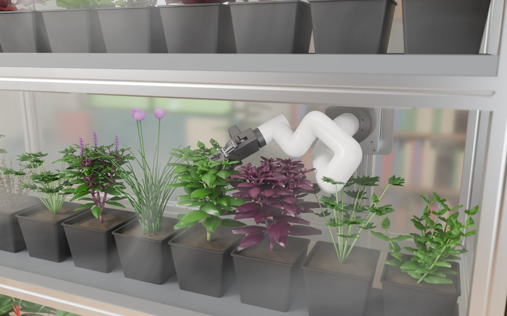
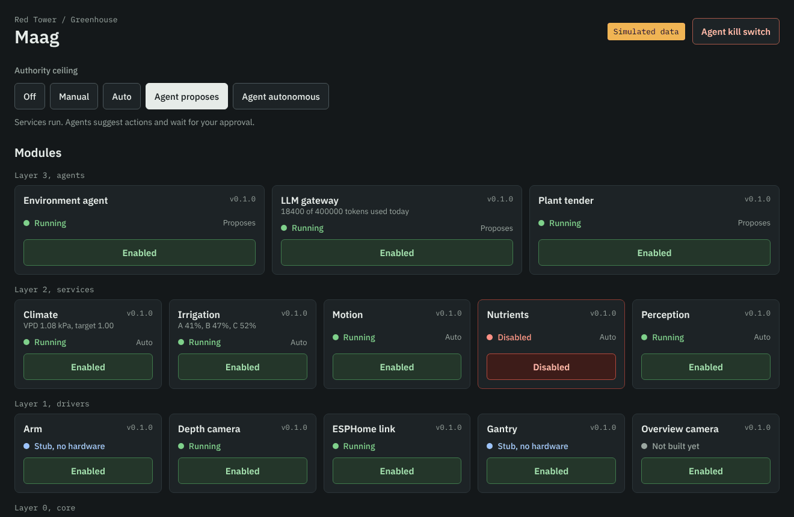
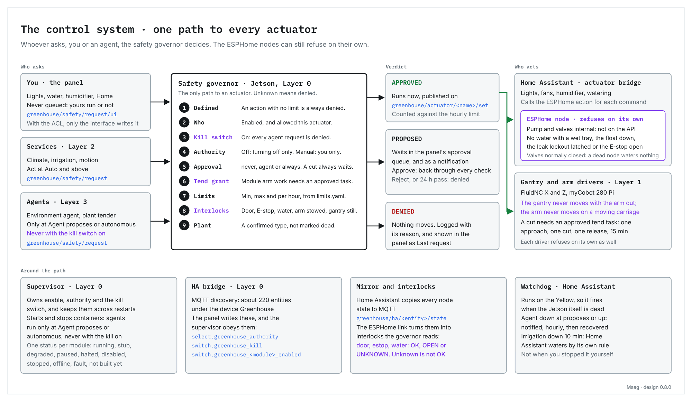
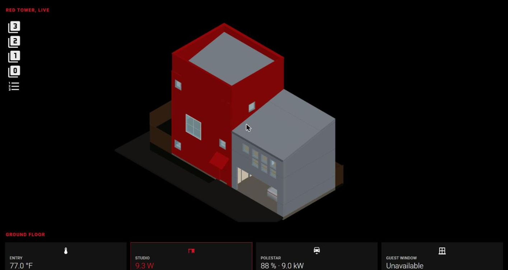

# Claude Agentic Greenhouse

**I am bad at keeping plants alive. So I turned it into an engineering project.**

An indoor greenhouse that an AI agent tends, written down so anyone can build
one. It scales from a 600 mm closet bay to a 3 m room wall: build the size your
space allows, with only the modules you want.


[](LICENSE)

[](docs/booklets/README.md)

*The reference `m` build, rendered from the design's own 3D model: the cover of every
assembly booklet. [Page through the booklets](#assembly-booklets).*

---

## Why this exists

I am not good at growing plants. Left to me, they die: too much water, then
too little, then the wrong light, and I only notice when it is too late.

At some point the engineer in me stopped treating that as a personal failing
and started treating it as a requirements problem. If I cannot be trusted to
remember to water, measure the soil. If I cannot read a leaf, point a camera at
it. If I cannot decide what a plant needs, hand the decision to something that
reads every sensor, every day, and never forgets. The only way I was ever going
to keep plants alive was to make keeping them alive a complex engineering
project.

This repository is that project. I needed one place to keep the frame, the
firmware, the code and the drawings together, and while I was at it I wrote it
down carefully enough that someone else can build their own. It is a personal
build in my house in Houston, shared so it can be replicated anywhere, at
whatever size your space allows.

If anything is unclear, or you build one and get stuck, write to me at
**contact@vittorionetti.com**. I am happy to help.

### Inspiration

The starting point was the
[AutonCorp Biodome Project](https://autoncorp.com/biodome), where Claude grows
Sol, a tomato, inside a sensor-filled biodome and shares the readings and its
own decisions on a live dashboard. Watching an AI read VPD, soil moisture and
CO2 and act on them for one plant is what made me want to try it for a whole
shelf of herbs. The environmental variables this greenhouse tracks are modelled
on theirs. Thank you to the people behind it.

---

## What it does

The hard part of growing indoors, for me at least, was never switching a pump
on a schedule. It was deciding what the plants need. So that decision goes to
something that can look at the plants, read the history and reason about it,
while the hardware keeps it from doing anything dangerous.

That is why the greenhouse senses more than it strictly needs to. Every pot has its own
moisture probe. Every tier measures air temperature, humidity, canopy
temperature by infrared, and the spectrum actually landing on the leaves. From
those it computes VPD and leaf VPD, which is what a plant physically
experiences, rather than the room's humidity reading. A depth camera on a robot
arm looks at individual plants. An agent on a Jetson reads all of it, proposes a
tending strategy, and acts inside limits it cannot talk its way out of.

And then, deliberately, the agent is given almost no authority.

---

## The part that matters: three layers, one actuator

A greenhouse that can water itself can also flood itself. The architecture is
built around that, not around the agent.

| layer | runs on | cadence | may actuate? |
|---|---|---|---|
| node firmware | ESP32-POE-ISO, one per tier + one utility | continuous | **yes, and it is the only layer that can** |
| Home Assistant | wherever you run it | seconds | no. It may *request*, through one named action |
| the agent | Jetson Orin Nano | minutes | no. It proposes, bounded by an authority ceiling |

The pump and the three zone valves are `internal: true` in the node firmware.
They are never exposed to the API. Home Assistant can call
`water_zone(zone, seconds)`; the node decides whether to honour it, and refuses
outright if any tray is wet, if the reservoir float is down, if the leak lockout
is latched, or if the E-stop chain is open. The lockout is sticky across
reboots, so a flooded tray cannot be cleared by power-cycling.

The agent sits one layer further out again, under an explicit ceiling:

```
Off → Manual → Auto → Agent proposes → Agent autonomous
```

plus a kill switch checked immediately before any motion command leaves the
Jetson. Flipping it stops the arm without having to agree on a state machine.

The design assumption is that the agent will eventually be wrong, and that
nothing it can be wrong about should be able to drown a shelf of basil.

---

## The interface and the controls

[](docs/07-home-assistant.md)

The whole greenhouse is driven from one view inside Home Assistant. Every module with its
status and an enable switch, the authority ceiling and the agent kill switch, the
environment, the power draw over 24 hours, all 27 plants with a card each, and the agent's
proposals waiting for a yes or a no. Every button on it that moves something is a request
to the same safety governor an agent has to ask, so the interface cannot do anything the
limits do not allow.

[](docs/07-home-assistant.md#the-control-system)

**[Read how it works and how to install it](docs/07-home-assistant.md).** The card runs on its
own simulated data with `demo: true`, so it can be tried in five minutes on any Home
Assistant. Download it from [the latest release](https://github.com/v1proxy/RedTower/releases/latest)
(the card, both packages and the view in one zip) or add this repository to HACS as a
Dashboard repository.

---

## Fail-safe by construction

Not by convention, by physics:

- Zone valves are **normally closed** and the pump needs a MOSFET actively held
  on, so a dead controller cannot water anything.
- The Z-axis brake is released **by** 24 V, so a power cut parks the mast rather
  than dropping it through the trays.
- The GFCI is **manual** reset. After a trip it stays off until a person pushes
  it. Deliberate, in a cabinet holding water and mains.
- The LED driver's dim input fails to **full light**, so a relay cutting its
  mains is the authoritative off. The dimmer is only a dimmer.
- Every tier node keeps its own clock and runs its own photoperiod ramp and
  thermostat. Pull the network out and the greenhouse keeps lighting,
  ventilating and sensing. Only the agent and the dashboards go away.

---

## Parametric

The only input is the space you have.

```bash
git clone https://github.com/v1proxy/RedTower.git
cd RedTower/design
python3 solve.py m          # the reference build
python3 solve.py xs s m l xl
```

That prints a complete design: frame bays and whether you need an interior
upright, shelf heights and headroom, how many pots fit and at what pitch, how
many moisture probes and ADCs that needs, LED watts per tier from a PPFD target,
irrigation flow per zone, reservoir size, node count, which network switch, and
the robot arm's reach geometry. Then it tells you every constraint you are close
to, and refuses outright on the ones you cannot build through.

| preset | space (mm) | tiers | pots | modules |
|---|---|---|---|---|
| `xs` | 600 × 360 × 1100 | 2 | ~12 | core only |
| `s` | 900 × 400 × 1500 | 3 | ~18 | + climate |
| `m` | 1397 × 457 × 1829 | 3 | ~28 | all — **the reference build** |
| `l` | 2100 × 560 × 2200 | 4 | ~48 | all |
| `xl` | 3000 × 610 × 2400 | 5 | ~110 | all |

Describe your own space instead:

```python
from params import Envelope
from solve import solve

print(solve(Envelope(
    name="kitchen-alcove",
    width=820.0, depth=380.0, height=1600.0,
    tiers=3, pot_size="4.5in",
    modules=(),            # core only: sense, light, water
    series=20,
), "0.1.0").report())
```

---

## Modular

**Core, in every build, at every size:** per-pot moisture, per-tier climate and
VPD, dimmable horticultural lighting on a local photoperiod schedule, zoned drip
irrigation, leak detection, and the interlocks above.

| module | adds | costs |
|---|---|---|
| `climate` | CO2 sensing, exhaust fans on a local thermostat, humidifier | ~$150 |
| `gantry` | C-Beam rail, carriage, stepper motion | 254 mm of your depth |
| `arm` | myCobot 280, the Herb Snip (a printed cut-and-hold tool), depth camera, Jetson; what it cuts goes to Harvest Rev B's dead-leaf tray and feeder | ~$800, and requires `gantry` |

The smallest build is a few hundred dollars of sensing, light and water in a
closet, with no robot anywhere near it. The largest is 110 plants on a room wall
with an arm on a 2.5 m rail. Both run the same firmware and the same interlocks.

### One counterintuitive result

A **deeper** cabinet makes the robot's job **harder**. The gantry corridor sits
behind the trays, so a deeper tray pushes the pots further from an arm that is
already behind them. With a 280 mm reach, past roughly 460 mm of depth the arm
can no longer reach the front of its own pot row. The reference build clears it
by 3 mm. The solver computes that margin and tells you when it goes negative,
which is the sort of thing you want to learn before you buy extrusion.

---

## Everything is generated

Nothing in `drawings/` is drawn by hand. Each file is a generator: run it and it
re-derives the sheet from the member table, the BOM and the firmware pin maps.
A drawing cannot drift from the thing it documents, because it is not a drawing,
it is a function of the design.

The same is true of the bill of materials, the sheet-metal DXFs that go to the
laser cutter, and the running-cost model.

## The house in 3D

[](house/floorplan/README.md)

The greenhouse lives in a house, and the house is on the dashboard too: an axonometric 3D model
of Red Tower, built from its Revit model in Blender, where each floor can be peeled away and
rooms carry live labels (temperatures, power, the robot vacuums). The car appears in the garage
while it is plugged in, with its charge level on the label, and the exterior is coloured as
built. The sky behind it follows the real weather and the sun's real position, and after dark
the windows light up while someone is home.
[`house/floorplan/README.md`](house/floorplan/README.md) is the whole method, from a
33,976-object Revit export to a 2.7 MB GLB, with every script and the patches the card needs.

---

## Layout

```
VERSION              the design version; every generated artifact is stamped
CHANGELOG.md         what changed, and what it would break for an existing build
design/
  params.py          the Envelope, the physical limits, the presets
  solve.py           envelope -> complete, checked design
docs/                the build guide, in order
  booklets/          every booklet page as an image, generated from the PDFs
  interface/         the panel's screenshots and the control system diagram, generated
dist/                the panel card where HACS looks for it, copied by greenhouse/ha/make_bundle.py
house/
  floorplan/         the house as a live 3D floor plan in Home Assistant: Blender scripts,
                     the card patches, the card configuration, and the guide
greenhouse/
  esphome/           node firmware: tier nodes + utility node
  ha/                the interface: the Greenhouse panel card, the Jetson package, the view,
                     and the generators for the release zip and the pictures
  homeassistant/     first-generation package: thresholds, fallback watering, node alerts
  jetson/            tending agents and the robot stack
  frame/             the cabinet's model and its assembly booklet
  gantry/            the X/Z gantry and the arm: model, BOM, assembly booklet
  snip/              the Herb Snip, the arm's cut-and-hold tool: model, print files, BOM, booklet
  booklet/           the page kit every assembly booklet is drawn with
  drawings/          frame, sheet metal and wiring, generated
  sendcutsend/       DXFs for the cutter, and the unfolder that makes them
  model/             the greenhouse as real 3D geometry
  build_bom_*.py     bill of materials, each revision a full generator
  opex_model.py      daily running cost: electricity and tokens
```

---

## Assembly booklets

Five illustrated booklets build the reference `m` build, in this order. Every
drawing in them is rendered from the design's own 3D model.

<!-- booklets:start (generated by greenhouse/booklet/make_gallery.py) -->
Each booklet can be paged through here before you print it: [**every page of every booklet**](docs/booklets/README.md). Click a page below to open it full size in its booklet.

### 1 · Frame Rev A

The cabinet: 4040 extrusion, the trays, the base pan and the drains. 26 pages, 21 steps.

<table>
<tr><td align="center" valign="top"><a href="docs/booklets/frame.md#5--every-joint-and-what-holds-it"></a><br><sub>5 · Every joint, and what holds it</sub></td><td align="center" valign="top"><a href="docs/booklets/frame.md#14--step-9--the-top-ring"></a><br><sub>14 · step 9: The top ring</sub></td><td align="center" valign="top"><a href="docs/booklets/frame.md#24--step-19--trays--the-same-three-times"></a><br><sub>24 · step 19: Trays · the same, three times</sub></td><td align="center" valign="top"><a href="docs/booklets/frame.md#25--step-20--drains--one-riser-on-the-fl-post"></a><br><sub>25 · step 20: Drains · one riser on the FL post</sub></td></tr>
</table>

[Page by page](docs/booklets/frame.md) · [PDF](greenhouse/frame/Maag_Frame_Assembly_Instructions_RevA.pdf) · [Guide](greenhouse/frame/FRAME_ASSEMBLY.md)

### 2 · Gantry Rev E

The X/Z gantry on the bench, its wiring, then into the cabinet with the arm. 33 pages, 27 steps.

<table>
<tr><td align="center" valign="top"><a href="docs/booklets/gantry.md#8--step-4--onto-the-rail-then-set-the-preload"></a><br><sub>8 · step 4: Onto the rail, then set the preload</sub></td><td align="center" valign="top"><a href="docs/booklets/gantry.md#21--wiring--power-and-the-safety-relay"></a><br><sub>21 · Wiring · power and the safety relay</sub></td><td align="center" valign="top"><a href="docs/booklets/gantry.md#30--step-24--hang-the-z-mast"></a><br><sub>30 · step 24: Hang the Z mast</sub></td><td align="center" valign="top"><a href="docs/booklets/gantry.md#32--step-26--z-carriage-arm-plate-arm"></a><br><sub>32 · step 26: Z carriage, arm plate, arm</sub></td></tr>
</table>

[Page by page](docs/booklets/gantry.md) · [PDF](greenhouse/gantry/Gantry_Assembly_Instructions_RevE.pdf) · [Guide](greenhouse/gantry/GANTRY_ASSEMBLY.md)

### 3 · Enclosure Rev A

Polycarbonate panels, the fans and the four doors, on the finished cabinet. 26 pages, 18 steps.

<table>
<tr><td align="center" valign="top"><a href="docs/booklets/enclosure.md#2--the-enclosure--what-goes-where"></a><br><sub>2 · The enclosure · what goes where</sub></td><td align="center" valign="top"><a href="docs/booklets/enclosure.md#8--how-it-closes--the-door-in-section"></a><br><sub>8 · How it closes · the door, in section</sub></td><td align="center" valign="top"><a href="docs/booklets/enclosure.md#16--step-8--right-panel--tape-then-the-panel"></a><br><sub>16 · step 8: Right panel · tape, then the panel</sub></td><td align="center" valign="top"><a href="docs/booklets/enclosure.md#24--step-16--front--hang-the-doors"></a><br><sub>24 · step 16: Front · hang the doors</sub></td></tr>
</table>

[Page by page](docs/booklets/enclosure.md) · [PDF](greenhouse/enclosure/Maag_Enclosure_Assembly_Instructions_RevA.pdf) · [Guide](greenhouse/enclosure/ENCLOSURE.md)

### 4 · Harvest Rev B

Where the cuts go: the dead-leaf tray in the base and the feeder on the right panel. 18 pages, 11 steps.

<table>
<tr><td align="center" valign="top"><a href="docs/booklets/harvest.md#2--harvest--where-every-cut-goes"></a><br><sub>2 · Harvest · where every cut goes</sub></td><td align="center" valign="top"><a href="docs/booklets/harvest.md#3--how-the-arm-drops"></a><br><sub>3 · How the arm drops</sub></td><td align="center" valign="top"><a href="docs/booklets/harvest.md#11--step-4--the-tray--slide-it-in"></a><br><sub>11 · step 4: The tray · slide it in</sub></td><td align="center" valign="top"><a href="docs/booklets/harvest.md#15--step-8--feeder--the-two-hoods"></a><br><sub>15 · step 8: Feeder · the two hoods</sub></td></tr>
</table>

[Page by page](docs/booklets/harvest.md) · [PDF](greenhouse/harvest/Maag_Harvest_Assembly_Instructions_RevB.pdf) · [Guide](greenhouse/harvest/HARVEST.md)

### 5 · Herb Snip Rev A

The arm's printed cut-and-hold tool: print it, build it, put it on the arm. 18 pages, 12 steps.

<table>
<tr><td align="center" valign="top"><a href="docs/booklets/snip.md#2--how-the-herb-snip-works"></a><br><sub>2 · How the Herb Snip works</sub></td><td align="center" valign="top"><a href="docs/booklets/snip.md#3--herb-snip--printed-parts"></a><br><sub>3 · Herb Snip · printed parts</sub></td><td align="center" valign="top"><a href="docs/booklets/snip.md#10--step-5--the-jaw-on-its-pivot-and-the-link"></a><br><sub>10 · step 5: The jaw on its pivot, and the link</sub></td><td align="center" valign="top"><a href="docs/booklets/snip.md#16--step-10--onto-the-arm"></a><br><sub>16 · step 10: Onto the arm</sub></td></tr>
</table>

[Page by page](docs/booklets/snip.md) · [PDF](greenhouse/snip/Maag_Herb_Snip_Assembly_Instructions_RevA.pdf) · [Guide](greenhouse/snip/HERB_SNIP.md)
<!-- booklets:end -->

---

## Build guide

1. [Choose your size](docs/01-choose-your-size.md)
2. [Bill of materials](docs/02-bill-of-materials.md)
3. [Frame assembly](docs/03-frame-assembly.md)
4. [Sheet metal](docs/04-sheet-metal.md)
5. [Electrical](docs/05-electrical.md)
6. [Firmware](docs/06-firmware.md)
7. [Home Assistant](docs/07-home-assistant.md)
8. Modules: [gantry](docs/08-gantry.md) · [arm, vision and the Jetson](docs/08-arm.md) · [climate](docs/08-climate.md)
9. [Commissioning](docs/09-commissioning.md)

---

## Versioning

This is a buildable design, so it is versioned like one. `VERSION` describes the
*design*, not the code.

- **MAJOR** — a change that makes an already-built unit wrong: a frame dimension,
  a pin reassignment, a part that is not a drop-in.
- **MINOR** — a new module, size preset or capability. Existing builds stay valid.
- **PATCH** — corrections, documentation, genuine drop-in substitutions.

Anyone who built against an older version can read down to their version and see
exactly what would have to change. See [`CHANGELOG.md`](CHANGELOG.md).

---

## Honest status

A design under construction, not a finished kit.

- The `m` build is fully drawn, specified and costed. The other four sizes are
  solved but not yet drawn.
- The generators still carry their own constants rather than reading from
  `design/`. Wiring them to the solver is the 0.2.0 work.
- **The LED part number is unresolved.** Both options in BOM Rev E are dead, and
  one of them was never electrically valid alongside the drivers specified next
  to it. [`docs/05-electrical.md`](docs/05-electrical.md) has the detail. Do not
  buy drivers until this closes.
- The Jetson is set up and its core layer (supervisor, safety governor, state
  store, Home Assistant bridge) runs on the reference build. The drivers,
  services and agents wait on the hardware they drive.
  [`docs/08-arm.md`](docs/08-arm.md) has the bring-up, including the steps that
  cost me an evening.
- The Home Assistant interface is packaged and checked against a bench Home
  Assistant in CI. My own Home Assistant still runs the first-generation card
  until I install this one; [`docs/07-home-assistant.md`](docs/07-home-assistant.md)
  lists what is not yet verified.

Open items live in `CHANGELOG.md` under the current version.

---

Built for [Red Tower](https://github.com/v1proxy/RedTower), a house in Houston,
and written down so it can be built somewhere else. Questions are welcome at
contact@vittorionetti.com.
