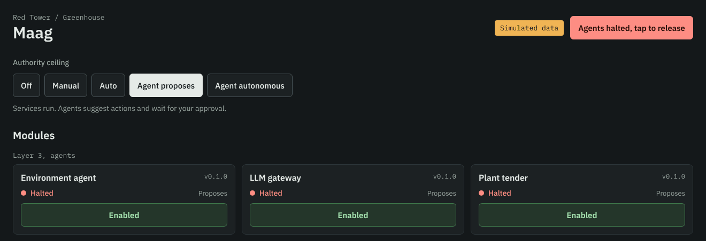
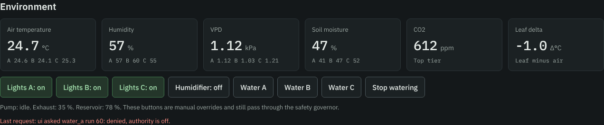
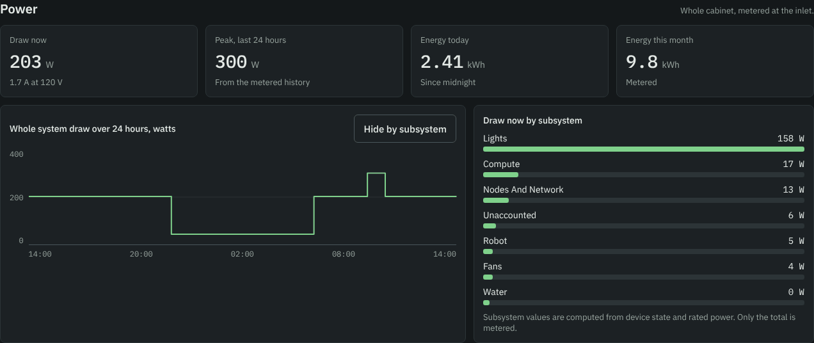
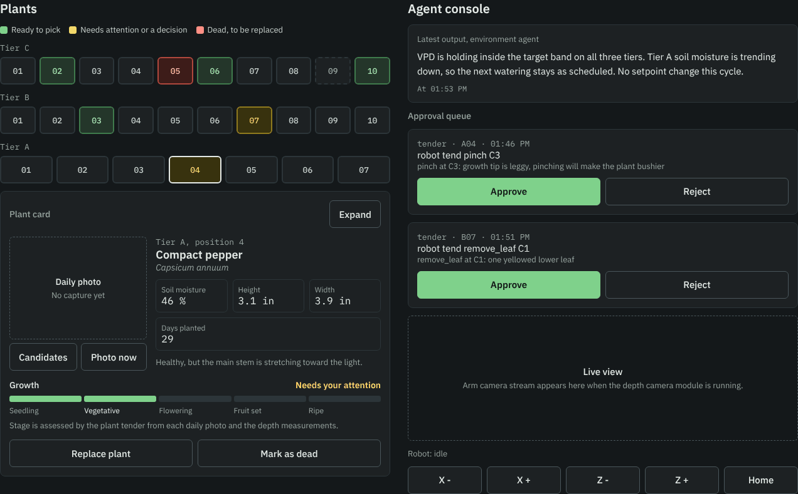
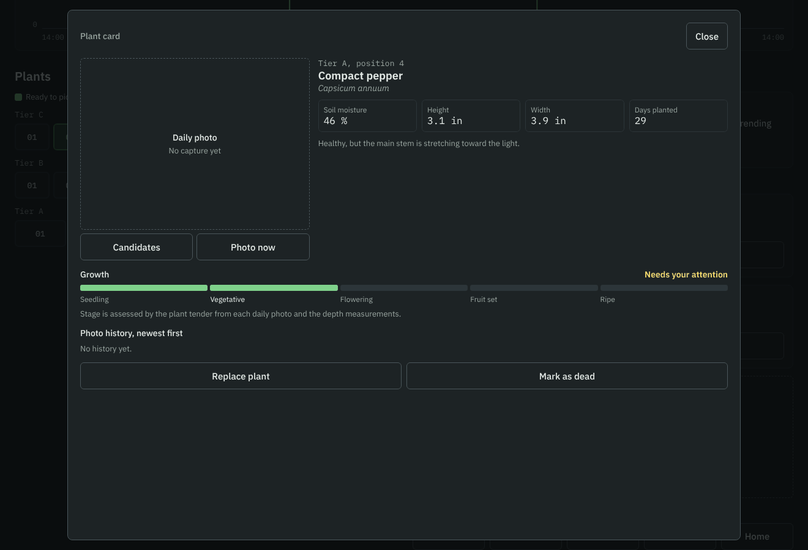
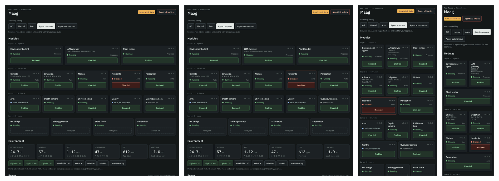

# Home Assistant: the interface and the controls

The whole greenhouse is driven from one view inside Home Assistant: the Greenhouse panel.
It shows every module, sensor and plant, and every button on it is a request to the same
safety governor an agent has to ask. This chapter explains that control system, then the
interface section by section, then how to install it.

[](interface/panel-desktop-1320.png)

*The panel at 1320 px, running on its own simulated data (`demo: true`). Click for the full page.*

**Download:** [the latest release](https://github.com/v1proxy/RedTower/releases/latest) carries
`maag-homeassistant-<version>.zip` (the card, both packages, the view, the broker files) and
`greenhouse-panel.js` on its own. To look before you build anything, [try it with simulated
data](#try-it-with-simulated-data): one file and a dashboard view, five minutes.

Contents

1. [The control system](#the-control-system)
2. [The interface, section by section](#the-interface-section-by-section)
3. [What every control sends](#what-every-control-sends)
4. [What the panel reads](#what-the-panel-reads)
5. [Install](#install)
6. [Check it](#check-it)
7. [Known issues and what is not verified](#known-issues-and-what-is-not-verified)
8. [Regenerating the pictures and the bundle](#regenerating-the-pictures-and-the-bundle)

---

## The control system

[](interface/control-system.svg)

Three machines, one broker:

| | runs | does |
|---|---|---|
| **Home Assistant** (a Yellow on the reference build) | the panel, two packages, the Mosquitto broker | shows everything, takes your requests, mirrors the ESPHome nodes to MQTT, turns approved commands into ESPHome actions, watches the agents |
| **Jetson Orin Nano Super** | the module stack in Docker: core, drivers, services, agents | decides. The safety governor is the only thing allowed to publish an actuator command |
| **Four ESP32 nodes** (three tiers and a utility node) | ESPHome | measures, switches, and refuses on its own: the pump and valves are not on the API at all |

### One path to every actuator

Anything that wants something to move, you included, sends a request. Only the safety governor
(`greenhouse/jetson/gh/core/safety.py`) may publish under `greenhouse/actuator/`, and the broker's
access list enforces that on the wire, not only in the code.

- **You** ask on `greenhouse/safety/request/ui`. Only the interface may write that topic, so the
  governor knows a request is yours from the topic, never from what the message claims.
- **Services** (climate, irrigation, motion) and **agents** (the environment agent, the plant
  tender) ask on `greenhouse/safety/request`, and each may only ask for the actuators its
  manifest lists.

The governor checks, in this order, and stops at the first failure:

1. **Who.** A module must be enabled and allowed this actuator.
2. **Kill switch.** On: every agent request is denied.
3. **Authority ceiling.** See the table below.
4. **Limits.** Minimum, maximum and per-hour totals from
   [`limits.yaml`](../greenhouse/jetson/config/limits.yaml). An action with no limit defined is
   always denied.
5. **Interlocks.** Door, E-stop, water, arm stowed, gantry still. `UNKNOWN` is not `OK`.
6. **Plant record.** Work at a plant needs a type you confirmed, and a plant not marked dead.
7. **Approval policy.** Per action: `never`, `agent` (an agent's request waits for you unless the
   ceiling is Agent autonomous) or `always` (any module's request waits, at every level).

Then one of three verdicts, each logged and shown in the panel:

- **Approved:** published on `greenhouse/actuator/<name>/set` and counted against its hourly limit.
- **Proposed:** waits in the panel's approval queue, with a phone notification. Approve, and it goes
  back through every check as if you had asked for it, because the door may have opened since.
  Reject it, or leave it 24 hours, and it is denied.
- **Denied:** nothing moves. The reason shows as the panel's **Last request** line.

Who acts on an approved command depends on what it is. Lights, fans, the humidifier and
watering go to Home Assistant's actuator bridge (an automation in `greenhouse_jetson.yaml`),
which calls the ESPHome action on the node. The node still refuses water with a wet tray, the
reservoir float down, the leak lockout latched or the E-stop open, and its valves are normally
closed, so a dead node waters nothing. The gantry and the arm are driven by their own drivers
on the Jetson, and each refuses to move unless the other is safe: the gantry never travels with
the arm out, the arm never moves on a moving carriage.

### The authority ceiling

One selector, five levels, owned by the supervisor and kept across restarts. A module can sit
below the ceiling (disabled), never above it.

| level | services (climate, irrigation, motion) | agents | your buttons |
|---|---|---|---|
| **Off** | stopped | stopped | only turning things off |
| **Manual** | running, but every request they make is denied except turning things off | paused | allowed, inside the limits |
| **Auto** | run the greenhouse | paused | allowed |
| **Agent proposes** | run | run. Watering, light level and photoperiod, fan duty, exhaust, humidifier and the VPD target wait for your approval | allowed |
| **Agent autonomous** | run | act inside the limits without asking | allowed |

At every level a cut waits for you: `robot.tend` is `approval: always`. An approved tend task
grants exactly one approach, one cut and one release at that plant, for 15 minutes.

Turning things off (`safe_off` in `limits.yaml`: lights off, stop watering, humidifier off,
gantry stop, arm park) is allowed at every level, Off included. The ESPHome failsafes hold
whatever the ceiling is.

### The kill switch

`switch.greenhouse_kill`. On, the supervisor stops every agent container and the governor
denies any agent request that is still in flight. The deterministic services keep running the
greenhouse. It is one entity: the panel's button, the supervisor and the watchdog all read the
same one.

### Around the path

- **Supervisor.** Owns the enable state of every module, the authority and the kill switch;
  starts and stops containers to match; publishes one status per module. A module whose
  dependency is down reads Degraded with what it is waiting on.
- **HA bridge.** Announces about 220 entities by MQTT discovery, under the device Greenhouse.
  New modules appear without editing a dashboard.
- **Mirror.** Home Assistant copies every node state to `greenhouse/ha/<entity>/state`, and
  resyncs every five minutes. The Jetson's ESPHome link turns those into the interlocks.
- **Watchdog.** Runs in Home Assistant, so it still fires when the Jetson itself is dead.
  At Agent proposes or autonomous, a stopped, faulted or silent agent, an LLM gateway that
  cannot reach the Claude API, or an environment agent with no cycle in 45 minutes raises
  `binary_sensor.greenhouse_agent_problem`: one notification naming the cause, again every
  hour while it lasts, and one when it clears. Nothing is sent when you stopped it yourself
  (kill switch, module disabled, ceiling below Agent proposes).
- **Watering fallback.** If the irrigation module is down for 10 minutes while it is enabled
  and the ceiling is Auto or above, Home Assistant waters by its own threshold rule and tells
  you. It hands back as soon as irrigation has run for two minutes.

---

## The interface, section by section

One custom card, `custom:greenhouse-panel`, shown as a panel view. No build step, no
dependencies, no network calls of its own. It renders the mockup's palette (dark ground,
green accent) at four target sizes, and when a part of the system does not exist yet, it says
so in place rather than hiding.

### Header and kill switch



The kill switch sits top right, red-outlined. Tapped, it fills red and reads **Agents halted,
tap to release**; the three agent tiles turn to Halted at once. If the Jetson stops answering,
a red banner says so above everything and every module reads Offline; the ESPHome nodes keep
the lights, fans and their own limits running.

### Authority ceiling

Five buttons, the current level filled. The line under them says what that level means in one
sentence. The level is `select.greenhouse_authority`, so it can also be set from an automation.

### Modules

One tile per module, grouped by layer: agents, services, drivers, core. Each tile shows the
module's version, its status, its mode (Auto, Manual, Proposes, Paused) and a one-line detail
(the VPD against target, today's token count, what a degraded module waits on).

| status | colour | means |
|---|---|---|
| Running | green | up and doing its job |
| Stub, no hardware | blue | running on its simulated backend, counted as present by its dependents |
| Degraded | amber | running, but a dependency is down: the detail names it |
| Disabled | red tile | switched off by you |
| Halted | red | an agent, stopped by the kill switch |
| Fault, Offline | red | reported a fault, or no heartbeat for 30 s |
| Paused | grey | an agent below Agent proposes |
| Stopped | grey | authority is Off |
| Not built yet | grey | defined, not installed |

The button under each tile enables or disables that module (`switch.greenhouse_<module>_enabled`).
The core four have no switch: they read **Always on**.

### Environment



Air temperature, humidity, VPD and soil moisture as the mean of the three tiers with each
tier underneath, CO2 from the top tier, and the leaf delta (canopy minus air, from the IR
sensors). Below them, the manual overrides: lights per tier, humidifier, watering per zone and
stop. They are requests like any other and pass the governor; the line under them shows the
latest decision. Above, at authority Off, a watering request was denied with its reason.

### Power



Draw now, the 24 hour peak, energy today and this month, all from the PZEM-004T meter at the
cabinet inlet. The single green line is the last 24 hours of metered draw at full width.
**Show by subsystem** opens the breakdown beside it; those values are computed from device state
times rated power, only the total is metered, and an **unaccounted** line shows the difference.
The same sensors feed Home Assistant's own Energy dashboard, so both always agree.

### Plants and the plant card



27 positions in three tiers, top tier first: green is ready to pick, yellow needs your
attention or a decision, red is dead and to be replaced, a dashed cell is empty. Tap a cell to
open its card: the daily photo from the arm camera (or its candidate overlay), common and
scientific name, soil moisture, height and width from the depth camera (inches or centimetres
following your Home Assistant unit system), days planted, and the milestone growth bar the
plant tender assesses from each day's photo.



**Expand** opens the card nearly full screen with the photo history. **Replace plant** asks for
the new type: your entry is the record, the camera only ever suggests one, and the tender
will not work on a position without a type you confirmed. **Mark as dead** turns the cell red.
**Photo now** sends the robot to take a fresh photo, through the governor like any move.

### Agent console

The environment agent's latest output in plain words with the actions it took and their
verdicts, then the approval queue: each proposal with who asked, which plant, what and why,
and **Approve** or **Reject**. Below, the arm camera's live view and the jog controls
(X and Z by 20 mm, Home); jogging is refused while a door is open, the E-stop is open or the
arm is out of its stowed pose.

### Four sizes

[](interface/panel-sizes.png)

Desktop 1320, a 10 in tablet at 1280 landscape, a 7 in tablet at 600 portrait, a phone at 390.
Full pages: [1320](interface/panel-desktop-1320.png) · [1280](interface/panel-tablet-1280.png) ·
[600](interface/panel-tablet-600.png) · [390](interface/panel-mobile-390.png). Every control is
at least 44 px tall, so it can be hit with a thumb.

---

## What every control sends

The panel never calls an ESPHome service and never publishes an actuator topic.

| control | sends | who decides |
|---|---|---|
| Kill switch | `switch.toggle` on `switch.greenhouse_kill` | supervisor |
| Authority buttons | `select.select_option` on `select.greenhouse_authority` | supervisor |
| Module Enabled / Disabled | `switch.toggle` on `switch.greenhouse_<module>_enabled` | supervisor |
| Lights A, B, C | `greenhouse/safety/request/ui`: `light_<tier>` `off` or `schedule_on` | governor |
| Humidifier | `humidifier` `on` for 5 min, or `off` | governor |
| Water A, B, C | `water_<tier>` `run` for `input_number.gh_run_<tier>` seconds (60 if missing) | governor, then the node |
| Stop watering | `water` `stop` | governor (always allowed) |
| Jog X, Z / Home | `gantry` `jog_x` or `jog_z` by 20 mm, `home` | governor, then the gantry driver |
| Approve / Reject | `greenhouse/proposal/<id>/decision`: `approve` or `reject` | governor checks again |
| Replace plant / Mark as dead | `greenhouse/store/cmd/ui`: `replace_plant` or `mark` | state store |
| Photo now | `greenhouse/motion/cmd`: `visit` the position | motion asks the governor for every move |
| Plant cell, Expand, Candidates, Show by subsystem | nothing: view only | |

---

## What the panel reads

All from MQTT discovery (the Jetson's bridge) or from the ESPHome nodes through Home
Assistant. Anything missing renders as `--` or as an empty placeholder, never as an error.

| section | entities |
|---|---|
| header, authority, modules | `binary_sensor.greenhouse_supervisor_alive`, `select.greenhouse_authority`, `switch.greenhouse_kill`, every `sensor.greenhouse_<module>_status` and `switch.greenhouse_<module>_enabled` |
| environment | `sensor.greenhouse_tier_<a,b,c>_{air_temperature, air_humidity, vpd, median_moisture, canopy_temperature}`, `sensor.greenhouse_tier_c_co2`, `light.greenhouse_tier_<t>_grow_light`, `switch.greenhouse_utility_humidifier`, `binary_sensor.greenhouse_utility_watering_active`, `fan.greenhouse_tier_c_exhaust_fans`, `sensor.greenhouse_utility_reservoir_level`, `sensor.greenhouse_last_decision` |
| power | `sensor.greenhouse_utility_cabinet_{power, current, voltage}`, `sensor.greenhouse_energy_today`, `sensor.greenhouse_energy_this_month`, every `sensor.greenhouse_power_<subsystem>`, and the history of the cabinet power |
| plants | `sensor.greenhouse_plant_<position>`, `sensor.greenhouse_observation_<position>`, `sensor.greenhouse_tier_<t>_<position>_moisture`, `camera.greenhouse_{photo, annotated, history}_<position>`, `sensor.greenhouse_tender_output` |
| console | `sensor.greenhouse_envagent_output`, `sensor.greenhouse_proposals`, `camera.greenhouse_live_d405`, `binary_sensor.greenhouse_robot_busy` |

Module tiles come from whatever `sensor.greenhouse_*_status` entities exist, so a module you
add to the Jetson appears in the panel by itself.

---

## Install

You need Home Assistant 2024.8 or newer. For live data you also need the MQTT integration on a
Mosquitto broker, the Jetson stack ([Jetson bring-up](08-arm.md#jetson-bring-up)) and the
ESPHome nodes ([firmware](06-firmware.md)). For a look, you need none of that.

### Try it with simulated data

1. Copy `greenhouse-panel.js` into `config/www/greenhouse/` (create the folder).
2. Settings, Dashboards, the three dots, **Resources**, **Add resource**:
   `/local/greenhouse/greenhouse-panel.js?v=0.8.0`, type **JavaScript module**.
3. Open any dashboard, **Edit**, the three dots, **Raw configuration editor**, and paste
   [`dashboard_view.yaml`](../greenhouse/ha/dashboard_view.yaml) under `views:`. Save.

The view opens with an amber **Simulated data** tag. Every button works: switch the authority,
pull the kill switch, approve a proposal, replace a plant. Nothing leaves the browser.

### From HACS (the card only)

HACS, the three dots, **Custom repositories**: `https://github.com/v1proxy/RedTower`,
type **Dashboard**. Install **Maag greenhouse panel**. HACS downloads the card from
[`dist/`](../dist/greenhouse-panel.js) and adds the resource for you; then paste the view as
above. HACS installs only the card: the packages below are copied by hand.

### The whole Home Assistant side

From the release, unzip `maag-homeassistant-<version>.zip`. Its `config/` folder mirrors
Home Assistant's own.

1. In `configuration.yaml`, if it is not there yet:

   ```yaml
   homeassistant:
     packages: !include_dir_named packages
   ```

2. Copy `config/packages/greenhouse.yaml` and `config/packages/greenhouse_jetson.yaml` into
   your `packages/` folder. Both are needed: `greenhouse.yaml` holds the thresholds, the run
   times the Water buttons use, the fallback watering rule and the node alerts;
   `greenhouse_jetson.yaml` holds the mirror, the actuator bridge, the watchdog, the energy
   sensors and the agent alerts.
3. In both files replace `notify.notify` with your phone's notify service, for example
   `notify.mobile_app_<phone>`.
4. Copy `config/www/greenhouse/greenhouse-panel.js` and add the resource as above, or install
   the card from HACS.
5. Broker: create the two Jetson logins (`broker/mosquitto-setup.md`). The access list
   (`broker/mosquitto-acl.sample`) is what makes "only the governor drives actuators" true on
   the wire; install it before the arm is live.
6. Restart Home Assistant. Once the Jetson's bridge has announced itself, the device
   **Greenhouse** appears under the MQTT integration with its entities.
7. Paste the view, then delete its `demo: true` line.
8. Energy dashboard: add `sensor.greenhouse_utility_cabinet_energy` as an individual device
   and call it Greenhouse. The six `sensor.greenhouse_energy_<subsystem>` sensors are
   computed, not metered: add them only as devices whose upstream device is Greenhouse, if your
   Home Assistant offers that setting, so nothing is counted twice.

### Updating

Copy the new files over the old ones and raise `?v=` on the resource to the new version, so
every browser and the companion app load the new card. HACS does the card for you.

---

## Check it

- **On real hardware:** [`COMMISSIONING.md`](../greenhouse/COMMISSIONING.md), step 3. Pass: the
  Greenhouse view shows every module with its status and Supervisor reads Running.
- **On a bench, no hardware:** `greenhouse/jetson/tools_ha_check.py` starts the Home Assistant
  Docker image with the package, a private Mosquitto with the access list and the whole stack,
  then checks that the configuration is valid, that every entity the package and the panel use
  exists, that an approved watering reaches the right ESPHome action, that the package logs no
  errors, and that the panel renders the real module states in headless Chromium. CI runs it
  on every push that touches `greenhouse/`.
- **The bundle:** `python greenhouse/ha/make_bundle.py --check` confirms the card's version, that
  `dist/` matches the source, and that every file the zip carries exists.

---

## Known issues and what is not verified

- **First-generation helpers in `greenhouse.yaml`.** The package still defines
  `input_select.gh_authority`, `input_boolean.gh_kill`, `input_boolean.gh_claude_autonomy`,
  `input_text.gh_proposal_plant` and `gh_proposal_action`, and the scripts `gh_robot_task` and
  `gh_tender_approve`, from the prototype tending scripts in `jetson/prototype/`. The stack does
  not read them and the panel does not show them. They still appear in Home Assistant's entity
  list: do not put them on a dashboard. The kill switch and the authority that count are
  `switch.greenhouse_kill` and `select.greenhouse_authority`. Taking them out of the package is
  open.
- **The reference build still runs the first-generation card** (the one in
  `greenhouse/homeassistant/www/`, which drives those helpers). Installing this card, step 3 of
  commissioning, is what makes the panel's kill switch the supervisor's.
- **Tablet and phone layouts are verified in a browser at their widths** (the pictures above),
  not yet on the devices.
- **The access list is not yet applied** on the reference build's broker.
- **The live view and the jog controls** wait on the depth camera module and a commissioned
  gantry. Until then they show their placeholders.
- **Fonts.** The card asks for IBM Plex Sans and IBM Plex Mono and uses the system font where
  they are not installed. The pictures were rendered with Plex installed.

---

## Regenerating the pictures and the bundle

Every picture in this chapter is generated, like the rest of the repository:

```
python greenhouse/ha/make_shots.py --fonts <folder of IBM Plex woff2>    # docs/interface/panel-*.png
python greenhouse/ha/make_control_diagram.py --fonts <Maag fonts>       # docs/interface/control-system.*
python greenhouse/ha/make_bundle.py                                     # dist/ and the release zip
```

`make_shots.py` loads the real card in headless Chromium with `demo: true`, so the pictures
are the card, not a mockup of it.
