# The assembly booklets

<!-- generated by greenhouse/booklet/make_gallery.py: do not edit -->

Every page of the five assembly booklets, 121 pages in build order. Click a page to read it full size in its booklet's page-by-page view; each booklet's PDF is the one to print.

| | booklet | what it builds | pages |
|---|---|---|---|
| 1 | [Frame Rev A](#1--frame-rev-a) | The cabinet: 4040 extrusion, the trays, the base pan and the drains. | 26 pages, 21 steps |
| 2 | [Gantry Rev E](#2--gantry-rev-e) | The X/Z gantry on the bench, its wiring, then into the cabinet with the arm. | 33 pages, 27 steps |
| 3 | [Enclosure Rev A](#3--enclosure-rev-a) | Polycarbonate panels, the fans and the four doors, on the finished cabinet. | 26 pages, 18 steps |
| 4 | [Harvest Rev B](#4--harvest-rev-b) | Where the cuts go: the dead-leaf tray in the base and the feeder on the right panel. | 18 pages, 11 steps |
| 5 | [Herb Snip Rev A](#5--herb-snip-rev-a) | The arm's printed cut-and-hold tool: print it, build it, put it on the arm. | 18 pages, 12 steps |

## 1 · Frame Rev A

The cabinet: 4040 extrusion, the trays, the base pan and the drains. 26 pages, 21 steps.

[Page by page](frame.md) · [PDF](../../greenhouse/frame/Maag_Frame_Assembly_Instructions_RevA.pdf) · [Guide](../../greenhouse/frame/FRAME_ASSEMBLY.md)

<table>
<tr><td align="center" valign="top"> 1 · Cover</td><td align="center" valign="top"><a href="frame.md#2--frame-and-trays--parts">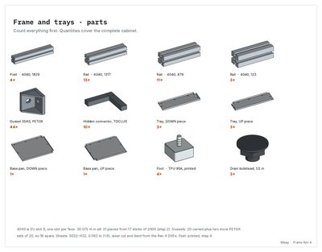</a> 2 · Frame and trays · parts</td><td align="center" valign="top"><a href="frame.md#3--frame-and-trays--fasteners">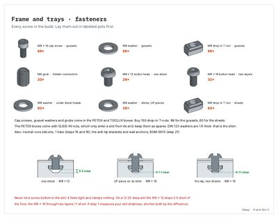</a> 3 · Frame and trays · fasteners</td><td align="center" valign="top"><a href="frame.md#4--tools">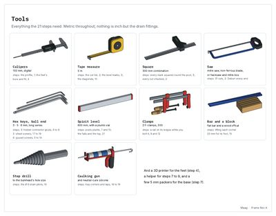</a> 4 · Tools</td></tr>
<tr><td align="center" valign="top"><a href="frame.md#5--every-joint-and-what-holds-it">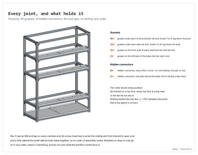</a> 5 · Every joint, and what holds it</td><td align="center" valign="top"><a href="frame.md#6--step-1--know-your-profile">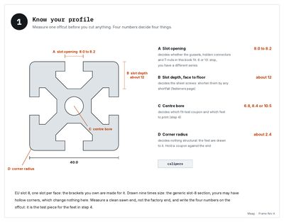</a> 6 · step 1: Know your profile</td><td align="center" valign="top"><a href="frame.md#7--step-2--cut-and-label">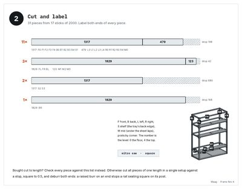</a> 7 · step 2: Cut and label</td><td align="center" valign="top"><a href="frame.md#8--step-3--mark-the-levels">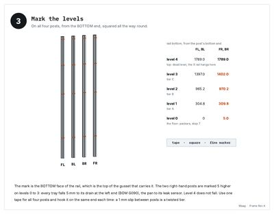</a> 8 · step 3: Mark the levels</td></tr>
<tr><td align="center" valign="top"><a href="frame.md#9--step-4--print-the-feet">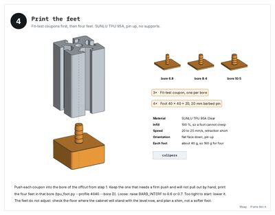</a> 9 · step 4: Print the feet</td><td align="center" valign="top"><a href="frame.md#10--step-5--the-base--front-back-and-the-mid-rail">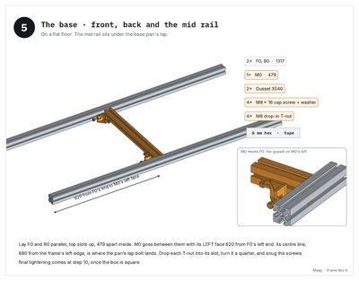</a> 10 · step 5: The base · front, back and the mid rail</td><td align="center" valign="top"><a href="frame.md#11--step-6--hidden-connectors-in-the-eight-floor-ends">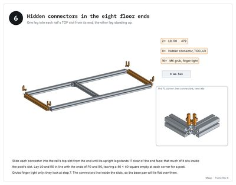</a> 11 · step 6: Hidden connectors in the eight floor ends</td><td align="center" valign="top"><a href="frame.md#12--step-7--stand-the-posts">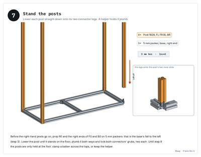</a> 12 · step 7: Stand the posts</td></tr>
<tr><td align="center" valign="top"><a href="frame.md#13--step-8--ledges-for-the-top">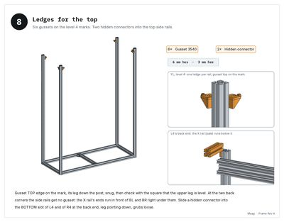</a> 13 · step 8: Ledges for the top</td><td align="center" valign="top"><a href="frame.md#14--step-9--the-top-ring">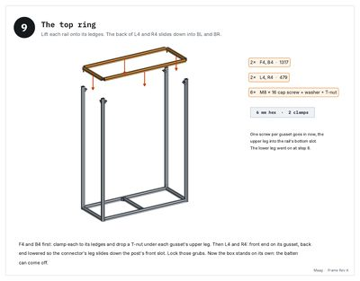</a> 14 · step 9: The top ring</td><td align="center" valign="top"><a href="frame.md#15--step-10--square-it-then-tighten">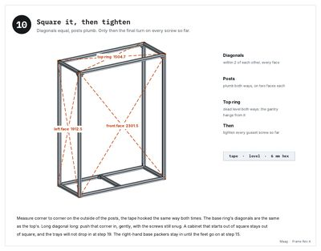</a> 15 · step 10: Square it, then tighten</td><td align="center" valign="top"><a href="frame.md#16--step-11--tier-a--eight-ledges">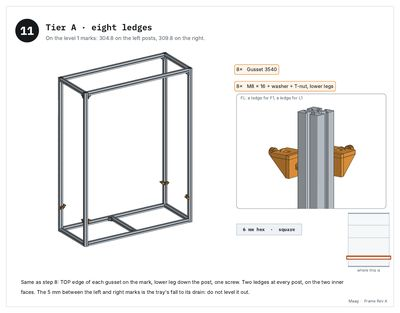</a> 16 · step 11: Tier A · eight ledges</td></tr>
<tr><td align="center" valign="top"><a href="frame.md#17--step-12--tier-a--front-back-and-side-rails">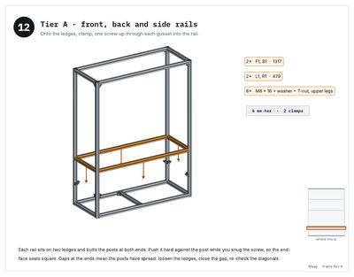</a> 17 · step 12: Tier A · front, back and side rails</td><td align="center" valign="top"><a href="frame.md#18--step-13--tier-a--the-tray-rails">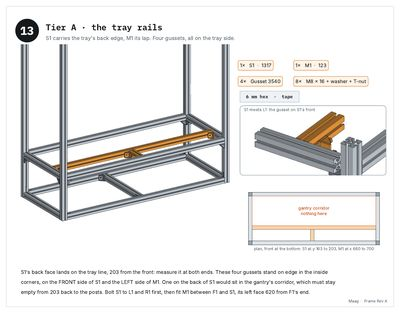</a> 18 · step 13: Tier A · the tray rails</td><td align="center" valign="top"><a href="frame.md#19--step-14--tiers-b-and-c--the-same-three-steps">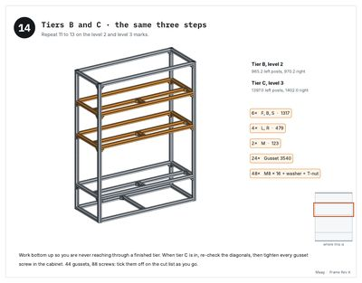</a> 19 · step 14: Tiers B and C · the same three steps</td><td align="center" valign="top"><a href="frame.md#20--step-15--the-feet">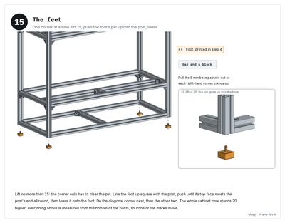</a> 20 · step 15: The feet</td></tr>
<tr><td align="center" valign="top"><a href="frame.md#21--step-16--the-sheets--check-drill-seal">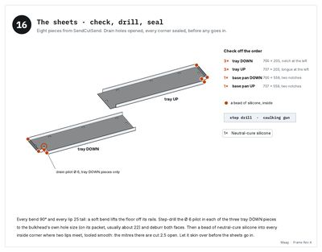</a> 21 · step 16: The sheets · check, drill, seal</td><td align="center" valign="top"><a href="frame.md#22--step-17--base-pan--t-nuts-then-the-down-piece">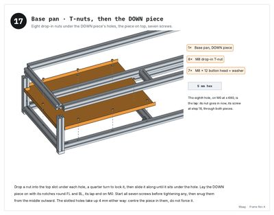</a> 22 · step 17: Base pan · T-nuts, then the DOWN piece</td><td align="center" valign="top"><a href="frame.md#23--step-18--base-pan--the-up-piece-over-the-lap">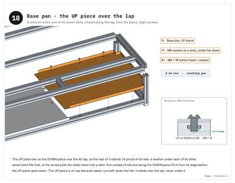</a> 23 · step 18: Base pan · the UP piece over the lap</td><td align="center" valign="top"><a href="frame.md#24--step-19--trays--the-same-three-times">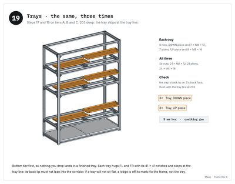</a> 24 · step 19: Trays · the same, three times</td></tr>
<tr><td align="center" valign="top"><a href="frame.md#25--step-20--drains--one-riser-on-the-fl-post">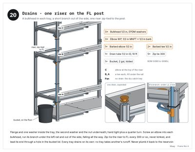</a> 25 · step 20: Drains · one riser on the FL post</td><td align="center" valign="top"><a href="frame.md#26--step-21--before-you-load-it">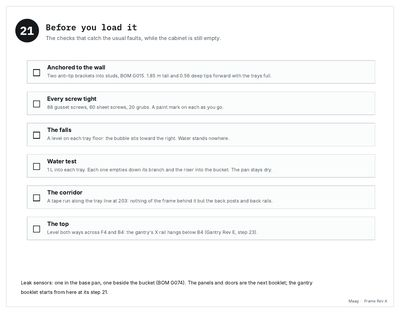</a> 26 · step 21: Before you load it</td></tr>
</table>

## 2 · Gantry Rev E

The X/Z gantry on the bench, its wiring, then into the cabinet with the arm. 33 pages, 27 steps.

[Page by page](gantry.md) · [PDF](../../greenhouse/gantry/Gantry_Assembly_Instructions_RevE.pdf) · [Guide](../../greenhouse/gantry/GANTRY_ASSEMBLY.md)

<table>
<tr><td align="center" valign="top"> 1 · Cover</td><td align="center" valign="top"><a href="gantry.md#2--gantry--parts">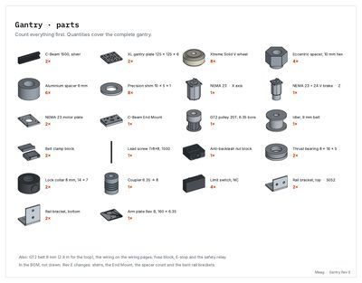</a> 2 · Gantry · parts</td><td align="center" valign="top"><a href="gantry.md#3--gantry--fasteners">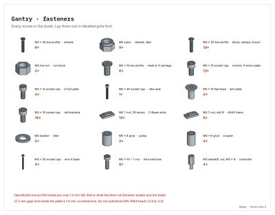</a> 3 · Gantry · fasteners</td><td align="center" valign="top"><a href="gantry.md#4--tools">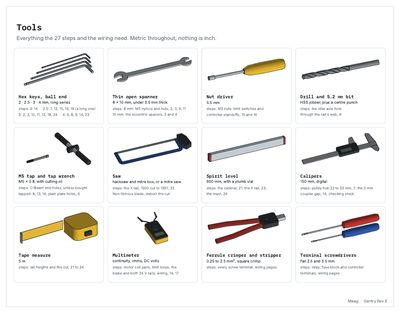</a> 4 · Tools</td></tr>
<tr><td align="center" valign="top"><a href="gantry.md#5--step-1--know-your-plate">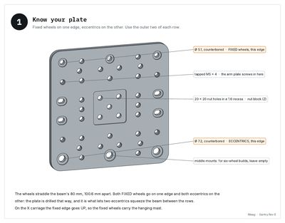</a> 5 · step 1: Know your plate</td><td align="center" valign="top"><a href="gantry.md#6--step-2--fixed-wheels--the-stack">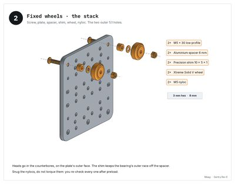</a> 6 · step 2: Fixed wheels · the stack</td><td align="center" valign="top"><a href="gantry.md#7--step-3--eccentric-wheels">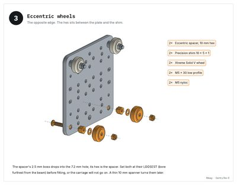</a> 7 · step 3: Eccentric wheels</td><td align="center" valign="top"><a href="gantry.md#8--step-4--onto-the-rail-then-set-the-preload">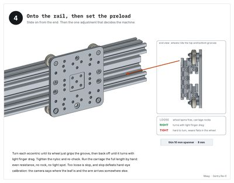</a> 8 · step 4: Onto the rail, then set the preload</td></tr>
<tr><td align="center" valign="top"><a href="gantry.md#9--step-5--build-the-second-carriage">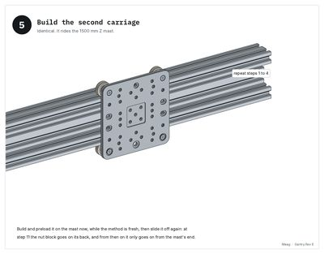</a> 9 · step 5: Build the second carriage</td><td align="center" valign="top"><a href="gantry.md#10--step-6--x-motor-onto-its-plate">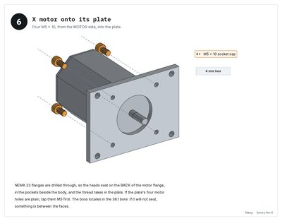</a> 10 · step 6: X motor onto its plate</td><td align="center" valign="top"><a href="gantry.md#11--step-7--pulley-onto-the-shaft">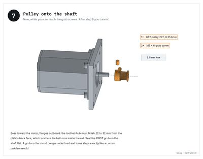</a> 11 · step 7: Pulley onto the shaft</td><td align="center" valign="top"><a href="gantry.md#12--step-8--motor-onto-the-rails-left-end">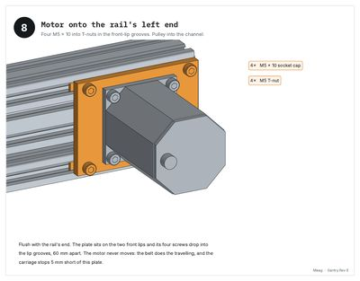</a> 12 · step 8: Motor onto the rail's left end</td></tr>
<tr><td align="center" valign="top"><a href="gantry.md#13--step-9--idler-at-the-far-end">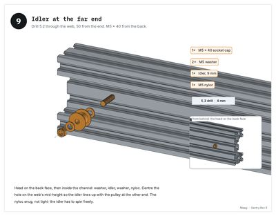</a> 13 · step 9: Idler at the far end</td><td align="center" valign="top"><a href="gantry.md#14--step-10--belt-and-clamps">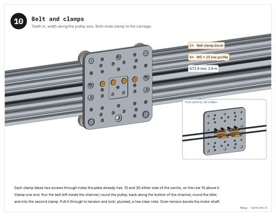</a> 14 · step 10: Belt and clamps</td><td align="center" valign="top"><a href="gantry.md#15--step-11--nut-block-onto-the-z-carriage">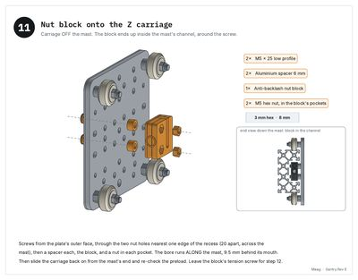</a> 15 · step 11: Nut block onto the Z carriage</td><td align="center" valign="top"><a href="gantry.md#16--step-12--lead-screw-through-the-nut">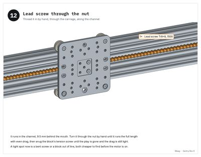</a> 16 · step 12: Lead screw through the nut</td></tr>
<tr><td align="center" valign="top"><a href="gantry.md#17--step-13--top-end--the-screw-hangs-here">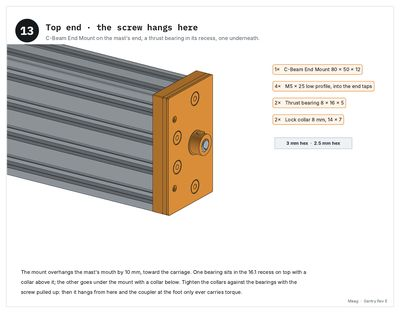</a> 17 · step 13: Top end · the screw hangs here</td><td align="center" valign="top"><a href="gantry.md#18--step-14--foot--braked-motor-and-coupler">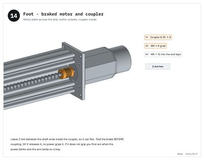</a> 18 · step 14: Foot · braked motor and coupler</td><td align="center" valign="top"><a href="gantry.md#19--step-15--limit-switches--all-four">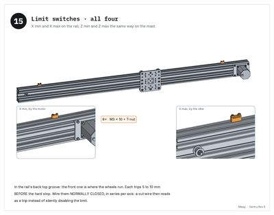</a> 19 · step 15: Limit switches · all four</td><td align="center" valign="top"><a href="gantry.md#20--step-16--controller-on-standoffs">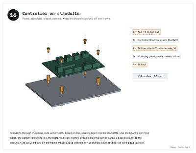</a> 20 · step 16: Controller on standoffs</td></tr>
<tr><td align="center" valign="top"><a href="gantry.md#21--wiring--power-and-the-safety-relay">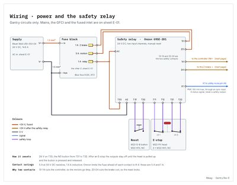</a> 21 · Wiring · power and the safety relay</td><td align="center" valign="top"><a href="gantry.md#22--wiring--controller-motors-brake-limits">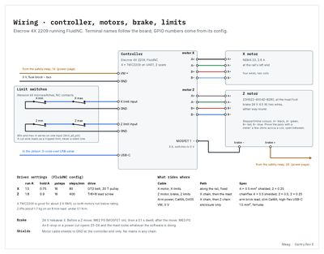</a> 22 · Wiring · controller, motors, brake, limits</td><td align="center" valign="top"><a href="gantry.md#23--step-17--first-motion-before-the-arm">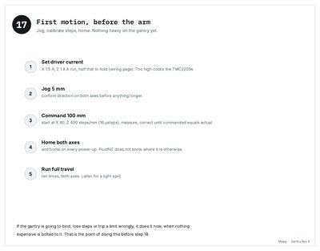</a> 23 · step 17: First motion, before the arm</td><td align="center" valign="top"><a href="gantry.md#24--step-18--arm-plate-onto-the-z-carriage">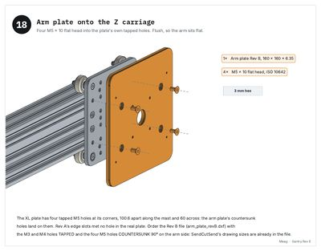</a> 24 · step 18: Arm plate onto the Z carriage</td></tr>
<tr><td align="center" valign="top"><a href="gantry.md#25--step-19--the-arm-last">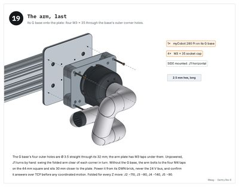</a> 25 · step 19: The arm, last</td><td align="center" valign="top"><a href="gantry.md#26--step-20--before-you-trust-it">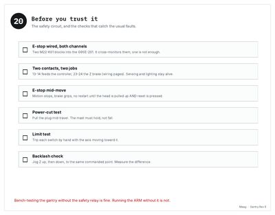</a> 26 · step 20: Before you trust it</td><td align="center" valign="top"> 27 · step 21: The cabinet the gantry lands on</td><td align="center" valign="top"> 28 · step 22: Why the cabinet got deeper</td></tr>
<tr><td align="center" valign="top"> 29 · step 23: X rail onto the rear uprights</td><td align="center" valign="top"> 30 · step 24: Hang the Z mast</td><td align="center" valign="top"> 31 · step 25: The Z drive, installed</td><td align="center" valign="top"> 32 · step 26: Z carriage, arm plate, arm</td></tr>
<tr><td align="center" valign="top"> 33 · step 27: Commissioned</td></tr>
</table>

## 3 · Enclosure Rev A

Polycarbonate panels, the fans and the four doors, on the finished cabinet. 26 pages, 18 steps.

[Page by page](enclosure.md) · [PDF](../../greenhouse/enclosure/Maag_Enclosure_Assembly_Instructions_RevA.pdf) · [Guide](../../greenhouse/enclosure/ENCLOSURE.md)

<table>
<tr><td align="center" valign="top"> 1 · Cover</td><td align="center" valign="top"> 2 · The enclosure · what goes where</td><td align="center" valign="top"> 3 · Enclosure · parts</td><td align="center" valign="top"> 4 · Enclosure · fasteners</td></tr>
<tr><td align="center" valign="top"> 5 · Tools</td><td align="center" valign="top"> 6 · Where every screw goes · sides and back</td><td align="center" valign="top"> 7 · Where every screw goes · top and front</td><td align="center" valign="top"> 8 · How it closes · the door, in section</td></tr>
<tr><td align="center" valign="top"> 9 · step 1: Before you start</td><td align="center" valign="top"> 10 · step 2: Clean every land, seal the post tops</td><td align="center" valign="top"> 11 · step 3: Back · tape</td><td align="center" valign="top"> 12 · step 4: Back · the bottom panel</td></tr>
<tr><td align="center" valign="top"> 13 · step 5: Back · the middle and upper panels</td><td align="center" valign="top"> 14 · step 6: Back · two battens over the seams</td><td align="center" valign="top"> 15 · step 7: Right panel · on the bench first</td><td align="center" valign="top"> 16 · step 8: Right panel · tape, then the panel</td></tr>
<tr><td align="center" valign="top"> 17 · step 9: Left side · take the riser off the post</td><td align="center" valign="top"> 18 · step 10: Left side · tape, grommets, the panel</td><td align="center" valign="top"> 19 · step 11: Left side · the riser on its P-clips</td><td align="center" valign="top"> 20 · step 12: Top panel · fans on the bench</td></tr>
<tr><td align="center" valign="top"> 21 · step 13: Top panel · on, and anchored to the wall</td><td align="center" valign="top"> 22 · step 14: Doors · on the bench</td><td align="center" valign="top"> 23 · step 15: Front · weatherstrip, magnets, switches</td><td align="center" valign="top"> 24 · step 16: Front · hang the doors</td></tr>
<tr><td align="center" valign="top"> 25 · step 17: Doors · adjust and check</td><td align="center" valign="top"> 26 · step 18: Before you plant</td></tr>
</table>

## 4 · Harvest Rev B

Where the cuts go: the dead-leaf tray in the base and the feeder on the right panel. 18 pages, 11 steps.

[Page by page](harvest.md) · [PDF](../../greenhouse/harvest/Maag_Harvest_Assembly_Instructions_RevB.pdf) · [Guide](../../greenhouse/harvest/HARVEST.md)

<table>
<tr><td align="center" valign="top"> 1 · Cover</td><td align="center" valign="top"> 2 · Harvest · where every cut goes</td><td align="center" valign="top"> 3 · How the arm drops</td><td align="center" valign="top"> 4 · Harvest · parts</td></tr>
<tr><td align="center" valign="top"> 5 · Harvest · fasteners</td><td align="center" valign="top"> 6 · Tools</td><td align="center" valign="top"> 7 · In section, to scale</td><td align="center" valign="top"> 8 · step 1: Before you start</td></tr>
<tr><td align="center" valign="top"> 9 · step 2: Base pan · the guide rails</td><td align="center" valign="top"> 10 · step 3: The tray · its handle</td><td align="center" valign="top"> 11 · step 4: The tray · slide it in</td><td align="center" valign="top"> 12 · step 5: The feeder · on the bench</td></tr>
<tr><td align="center" valign="top"> 13 · step 6: Right panel · well nuts in, temporary screws out</td><td align="center" valign="top"> 14 · step 7: Feeder · hang the two basins</td><td align="center" valign="top"> 15 · step 8: Feeder · the two hoods</td><td align="center" valign="top"> 16 · step 9: Feeder · the lid</td></tr>
<tr><td align="center" valign="top"> 17 · step 10: Trays in, the switch into the door chain</td><td align="center" valign="top"> 18 · step 11: Before the first harvest</td></tr>
</table>

## 5 · Herb Snip Rev A

The arm's printed cut-and-hold tool: print it, build it, put it on the arm. 18 pages, 12 steps.

[Page by page](snip.md) · [PDF](../../greenhouse/snip/Maag_Herb_Snip_Assembly_Instructions_RevA.pdf) · [Guide](../../greenhouse/snip/HERB_SNIP.md)

<table>
<tr><td align="center" valign="top"> 1 · Cover</td><td align="center" valign="top"> 2 · How the Herb Snip works</td><td align="center" valign="top"> 3 · Herb Snip · printed parts</td><td align="center" valign="top"> 4 · Herb Snip · purchased parts</td></tr>
<tr><td align="center" valign="top"> 5 · Tools</td><td align="center" valign="top"> 6 · step 1: Print the parts</td><td align="center" valign="top"> 7 · step 2: Fit the crank to your servo's horn</td><td align="center" valign="top"> 8 · step 3: The blade between the jaw halves</td></tr>
<tr><td align="center" valign="top"> 9 · step 4: Pads, anvil and the pivot insert</td><td align="center" valign="top"> 10 · step 5: The jaw on its pivot, and the link</td><td align="center" valign="top"> 11 · step 6: The crank on the servo, at closed</td><td align="center" valign="top"> 12 · step 7: The servo into the housing</td></tr>
<tr><td align="center" valign="top"> 13 · step 8: Regulator and leads</td><td align="center" valign="top"> 14 · Wiring · the Herb Snip</td><td align="center" valign="top"> 15 · step 9: The camera on its ring</td><td align="center" valign="top"> 16 · step 10: Onto the arm</td></tr>
<tr><td align="center" valign="top"> 17 · step 11: Where the cuts go</td><td align="center" valign="top"> 18 · step 12: Commission</td></tr>
</table>
