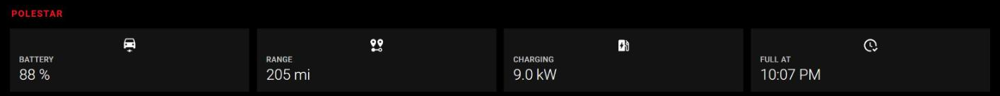

# From Blender to Home Assistant: a 3D floor plan dashboard

How the Red Tower model went from a Revit export in Blender to a live, axonometric 3D floor plan in Home Assistant, with floors you can peel away, rooms that show live data, and furniture rebuilt from photos.

Red Tower is the worked example throughout. The method applies to any building model; the numbers you would change for your own house are called out.

[](../../docs/house/3d-view.png)

*The 3D tab, live: floor buttons at the top left, the Polestar tile in the row under the model.*

---

## 1. What you end up with

- One GLB file (2.7 MB) served from Home Assistant at `/local/3d/redtower.glb`.
- A Lovelace card (`floor3dpro-card`, patched for an orthographic camera) on the `red-tower` dashboard, `3D` tab.
- Four levels you can hide one by one (roof, third, second, ground). Walls are cut 4 ft above each floor, the standard floor plan cut, so rooms and furniture show when the level above is hidden.
- Rooms that are clickable floor surfaces, floating labels with live values (temperature, power, vacuum state), coloured status strips for doors and windows, robot vacuum markers, and light anchors ready for smart lights.
- The car: a Polestar 2 that appears in the garage while it is plugged in, and its charge level on the garage label, on the 3D tab and on the Home tab.

## 2. Tools

| Tool | Used for |
|---|---|
| Blender 5.2 (any 4.x/5.x works) | All geometry work, run headless from scripts |
| Python 3 with numpy, scipy, matplotlib | Floor and room analysis outside Blender (optional) |
| Home Assistant with HACS | Hosting the model and the card |
| HACS: `floor3dpro-card` (levonisyas, MIT) | The 3D card, derived from `floor3d-card` by adizanni |
| File Editor add-on (or Samba, or Studio Code Server) | Getting the GLB into `/config/www` |
| Node.js + Playwright Chromium (optional) | Rendering the card headless to check the result before uploading |

Everything mentioned here is in this folder: `blender/` (the geometry scripts), `card/` (the card patches and the card configuration) and `preview/` (the headless check). Your own model and the GLB built from it stay outside the repository.

## 3. The source model and why it can't be used as is

`redtower.blend` is a Revit 3D view exported and imported into Blender. It has three problems for a dashboard:

1. **No usable names.** 33,976 objects all called `Red Tower - 3D View.NNN`. The card binds Home Assistant entities to objects by name, so there is nothing to bind to.
2. **Far too heavy.** 2.02 million triangles. 1.37 million of them are hardware nobody will ever see at dashboard scale: FAKRO skylight seals, rails and actuators (one rubber gasket alone is 615,350 triangles), cabinet handles, door hinges.
3. **Units are feet**, while the card works in centimetres (light distances, label sizes and room highlight heights are all in cm).

Also worth knowing: every mesh carries all 41 Revit materials as slots, and the materials have no colours (all default grey), so colour has to be assigned from scratch.

Run `blender/inspect.py` first on any new model. It reports object count, triangle count, units, bounding box, collections, materials and the heaviest objects:

```
blender -b redtower.blend --python blender/inspect.py -- inspect.json
```

## 4. Reading the building: floors, ceilings and rooms

Before cutting anything you need the floor elevations and the room outlines. I exported the raw geometry once and analysed it with numpy (`blender/analysis/`):

```
blender -b redtower.blend --python blender/export_raw.py -- work/raw.npz
cd blender/analysis && python a1.py     # materials by area, floor elevations
python slice.py                          # plan sections of every level
python rooms.py '<seeds json>' <floor_ft> <tag>   # room outlines by flood fill
python rz.py                             # floor and ceiling height per room
```

How each step works:

- **Floor elevations.** Histogram the Z of every upward-facing triangle, weighted by area. Peaks are floors. Red Tower: 0, 9 and 18 ft, roof around 26 to 33 ft.
- **Ceilings.** Same with downward-facing triangles: 8.0 to 8.5 ft on the ground floor, 17.0 on the second, a sloped ceiling of 9.3 to 10.4 ft above the third floor.
- **Plan sections.** Intersect all triangles with a horizontal plane 4 ft above each floor and draw the segments. That is a floor plan.
- **Rooms.** Rasterise the 4 ft and 2.5 ft sections (closed doors and window glass included, so openings are sealed) and flood-fill from a seed point in each room. Each region gives the room's rectangle.
- **Naming rooms.** Fixtures tell you what each room is: a tub and toilet make a bathroom, a range and island a kitchen, a closet makes a bedroom. Match those to your Home Assistant areas (`config/area_registry/list` and `config/floor_registry/list`).

Red Tower result (feet, plan coordinates):

| Level | Room | x | y |
|---|---|---|---|
| Ground (0) | guest_room | -41.8 to -35.5 | 0.5 to 8.2 |
| | studio | -42.0 to -31.9 | 8.8 to 19.3 |
| | bath_l1 | -31.5 to -26.7 | 7.8 to 14.3 |
| | entry | -26.4 to -19.9 | 0.5 to 9.8 |
| | garage | -19.3 to 0.3 | 0.5 to 19.5 |
| Second (9) | kitchen | -42.0 to -26.7 | 0.5 to 19.3 |
| | hall_l2 | -26.4 to -19.6 | 4.4 to 19.3 |
| | living_room | L-shape, -19.4 to 0.0 | 0.5 to 19.3 |
| Third (18) | bedroom | -41.8 to -27.2 | 0.5 to 13.8 |
| | bath_l3 | -41.8 to -36.1 | 14.4 to 19.3 |
| | closet_l3 | -35.4 to -29.0 | 14.2 to 17.8 |
| | office | -26.4 to -19.9 | 0.5 to 5.5 |

## 5. Building the dashboard model (`build_ha.py`)

One headless run, about 3 minutes:

```
blender -b redtower.blend --python blender/build_ha.py -- ha-floorplan
```

It never saves over the source file. In order:

### 5.1 Apply transforms
Bake every object's transform into its mesh and reset the object to identity. The card flattens the scene hierarchy when it sorts objects into levels, so parent transforms would be lost anyway.

### 5.2 Map materials to a palette
The 41 Revit materials map onto about 20 palette materials (`wall`, `floor`, `clad_red`, `glass`, `casework`, `appliance`, `sanitary`, `furniture`, `site_ground`...). Hardware materials map to `drop` and their faces are deleted.

Do this with `material.user_remap(new_material)`, once per source material. Assigning slots object by object is quadratic in Blender (each assignment rescans every object) and took more than 10 minutes on 34k objects without finishing; the bulk remap takes seconds.

Two override rules run first, while the original names are still visible:
- **Site**: objects outside the building footprint and lower than 6 ft become `site_ground`, `site_paving` or `site_fence`.
- **Stairs**: untyped objects inside the stair zone become `floor`.

### 5.3 Cut into levels
The card shows or hides whole levels, so every element has to belong to exactly one level. Objects that span levels (exterior walls, cladding, stairs) are cut with `bmesh.ops.bisect_plane`, and the cut is capped with `bmesh.ops.holes_fill` in a dark `cut` material, which gives the architectural poché on wall tops.

The cut heights are 4 ft above each floor: **4, 13 and 22 ft**. Everything from 4 ft above one floor to 4 ft above the next belongs to the upper level, so hiding a level shows the floor below cut at 4 ft, like a drawn plan. (Cutting just under the ceilings instead keeps full-height walls, which hide furniture against any wall facing the camera.)

One extra rule: east of x = -19.6 ft the house is only two storeys, so anything there above the second-floor cut goes to the roof level.

### 5.4 Join, split and simplify
- Join all pieces of a level into one mesh. `bpy.ops.object.join` costs about 0.15 s per object here (over an hour for one level), so the script concatenates vertex, loop and polygon arrays with numpy instead (seconds).
- Split the joined mesh by palette material, giving one single-material object per level and material, named `lvl00Nmaterial_lN`.
- Merge by distance, then limited dissolve (1 degree) on everything. Heavy categories (appliances, fixtures, sanitary, furniture, skylights) are then capped with Collapse decimation.

### 5.5 Add the objects Home Assistant binds to
- **Rooms**: a flat plane per room, 0.1 ft above the floor, named `room_<area>`. The card's `room` type needs "room" in the name.
- **Light anchors**: a small disc at ceiling height per room, `light_<room>`, facing down with backface culling, so it is invisible from above. The card puts a point light at its centre when bound to a light entity.
- **Status strips**: thin boxes at door thresholds and window sills (`door_balcony`, `window_guest_room`), coloured by contact sensors.
- **Devices**: pucks for the robot vacuums (`vacuum_sagan`, `vacuum_asimov`).

### 5.6 Scale and name
Scale everything by 30.48 (ft to cm). Mesh data gets the object name plus `_geo`, so glTF node names never collide with mesh names.

## 6. Naming rules the card depends on

These come from reading the card's source; break one and bindings silently fail.

- **Level prefix.** The card looks for `lvl(\d{3})` in each node name, puts the node in that level and then strips the first 6 characters. So `lvl002room_bedroom` becomes `room_bedroom` in the card config. Nodes without a prefix go to level 0.
- **One material per bindable object.** The `color` type clones `object.material`; a multi-material mesh loads as a group without one, and the card throws.
- **Unique names**, flat hierarchy, identity transforms.
- **`_hole_`** in a name makes the object invisible, and **`transparent_slab`** makes it a see-through slab (not used here).

## 7. Finalise and export (`finalize.py`)

The card centres the model by its size, not its position (`position = -size / 2` on X and Z, `-min` on Y). If the model's minimum corner is not at the origin, it ends up off-centre. `finalize.py` moves the bounding-box minimum to the origin and exports:

```python
bpy.ops.export_scene.gltf(filepath=glb, export_format='GLB', export_apply=True,
    export_yup=True, export_cameras=False, export_lights=False,
    export_texcoords=False, export_normals=True, export_materials='EXPORT')
```

No Draco: the card does not register a Draco decoder.

Red Tower offset (cm): x +1680.53, y -708.91, z +30.48. To turn a plan point in feet into the card's coordinates (useful for camera targets):

```
card_x = x_ft * 30.48 + 1680.53 - 851.85
card_y = z_ft * 30.48 + 30.48
card_z = -(y_ft * 30.48 - 708.91) - 510.86
```

(851.85 and 510.86 are half the model size in X and Z.)

## 8. Materials that read well in the card

- **Metallic 0 everywhere.** The card has no environment map, so metallic surfaces render nearly black. That is why the first red cladding looked maroon.
- Brighter base colours than you would use in a renderer; the card's light is flat.
- Real finishes: ground floor raw concrete `#9C9890`, upper floors light wood `#CFAF82`, red cladding `#C0282B`, grey cladding and roofs `#AEB2B7`, aluminium window frames `#B7BBBF`, walls `#E9E3D9`, glass `#A9CFE0` at 28 % opacity (alpha blend).
- Scripts: `repaint.py` (palette), `repaint2.py` (concrete garage), `repaint3.py` (floor finishes, and splits the ground-floor stair treads out of the slab so they stay wood), `repaint4.py` (mid grey roofs and grey cladding #AEB2B7, skylight panels and steel), `repaint5.py` (red parapet, coping, door, awning, downspouts and scuppers; aluminium window frames; exposed wall faces take the nearest cladding colour, found with sky-visibility rays).

## 9. Furniture from photos (`furnish_bedroom.py`, `furnish_living.py`)

The Revit model already had the kitchen, island, dining set and bathroom fixtures. Loose furniture was rebuilt room by room from phone photos:

1. **Locate the camera.** Match windows in the photo to windows in the model (the bedroom's big window is on the west wall; the small high window sits on the south wall next to the corner). That fixes which wall is which.
2. **Identify each piece and take the maker's dimensions.** IKEA TARVA queen bed (209 x 160 cm, headboard 92 cm, footboard 32 cm). Flos Parentesi (11 cm base, 58 cm element, R125 spot). MUJI polypropylene storage case, shallow, 3 drawers (26 x 37 x 32.5 cm), inside a 2020 aluminium frame.
3. **Estimate only what is not published** (here, the bedside table legs, about 18 cm) and flag it.
4. **Model low-poly but recognisable**: boxes and cylinders, headboard slats, drawer divisions, the Parentesi's bent tube as a swept polyline.
5. **Measure the real ceiling** with `scene.ray_cast` so hanging lamps reach it (the bedroom ceiling slopes, 9.3 ft at the headboard wall).
6. **Name for binding**: each lamp head is `light_bedroom_w` / `light_bedroom_e`, ready for the card's `light` type.

Re-runnable on the working file:

```
blender -b ha-floorplan/redtower_ha.blend --python blender/furnish_bedroom.py -- ha-floorplan
```

The living room went the same way (`furnish_living.py`): two white open bookcases forming an L by the stair (36.5 cm cells, 5 rows, 182 cm tall, filled with book blocks), an L sofa with its chaise, a Flos Arco (240 cm tall, 215 cm reach, 32 cm shade, per the maker) and the TV, whose screen is its own object so a `media_player` can light it. The bookcase and sofa sizes are estimated from the photos; the Arco's are published.

## 9b. Exterior trims by geometry (`repaint5.py`)

The Revit export has no family names, so "the downspout" or "the awning" cannot be selected by name. `repaint5.py` finds them by geometry instead:

- **Frame parts** (the beige trim material) are split into connected pieces. A piece inside the door's box, the awning's box or a downspout's column on the street face becomes red; the parapet coping (everything above 1040 cm) becomes red; any piece touching glass is a window frame and becomes aluminium. The boxes came from picking points on the rendered card (the card's own raycaster returns the object and the hit point).
- **Wall faces** seen from outside take the colour of the nearest facade cladding. A face counts as outside if a ray from it, tilted 20 or 45 degrees upward, escapes to the sky. Wall faces that run from a room up past the roof are first split at the roof planes, so the parapet's inner face is tested on its own. Small reveals inside a clad wall (the roof scuppers) are caught separately: perpendicular to the cladding, within 30 cm of it, and not next to glass.

## 9c. The car (`furnish_car.py`)

A Polestar 2 from its published size (4606 x 1859 x 1479 mm, wheelbase 2735 mm, 245/45 R19 tyres), lofted from a side profile and a plan width, with wheel arches cut by raising the underside over each axle. Light grey body, black glass from the windscreen over the roof to the rear window, and the full-width red rear light. It is parked nose-in on the right side of the garage, 85 cm off the side wall. Five single-material objects (`car_polestar_body`, `_glass`, `_tires`, `_rims`, `_tail`), so the card can show and hide them together as an object group.

## 10. Check before uploading (optional)

`preview/` renders the real card in headless Chromium with a stub `hass` object, so you see exactly what the dashboard will show:

```
copy floor3dpro-axo-card.js and 3d/redtower.glb next to index_axo.html
python -m http.server 8765
PAGE=index_axo.html node shot.js card_config.json states.json out.png 3,2   # last argument: levels to hide
```

The stub page needs a fake `<home-assistant>` element with nested shadow roots (`home-assistant-main`, `ha-panel-lovelace`, `hui-root`, `hui-view`), because the card walks that DOM to detect panel mode.

If you render previews in Blender instead, set the camera's `clip_end` to something like 100000: in centimetres the default of 100 clips everything and you get blank images.

## 11. Deploying to Home Assistant

### 11.1 Upload the model
Put the GLB in `/config/www/3d/` (served as `/local/3d/`). Any of these works:
- **File Editor add-on**: Upload button, folder `www/3d`. (Its API accepts the same thing: `POST <ingress>/api/upload` with form fields `path=/homeassistant/www/3d` and `file`.)
- Samba share `\\<ha-host>\config\www\3d`.
- Studio Code Server: drag the file into `www/3d`.

Home Assistant caches `/local` files, so always load the model with a version query in the card (`objfile: redtower.glb?v=20261025i`) and change it on every upload.

### 11.2 Install the card and make it axonometric
1. HACS > Frontend > search **Floor3D Pro Card** > Download.
2. Build the patched copy from the file HACS installed (`/config/www/community/floor3dpro-card/floor3dpro-card.js`):
   ```
   node card/build_card.js floor3dpro-card.js floor3dpro-axo-card.js
   ```
   It applies three patches, all written against the minified file with patterns rather than line numbers:
   - `axo_patch.js`: swaps in an `OrthographicCamera` whose frustum follows the canvas aspect, with a new option `ortho_half_height` (half the visible height, cm); stacks the level buttons highest first (3, 2, 1, 0, then "all"); renames every `floor3dpro-*` custom element to `floor3dpro-axo-*` so the copy runs beside the HACS card (renaming only the card is not enough, its form fields collide too); and makes the card's model cache copy mesh geometry when it clones the model. Without that, the room-label code moves the shared geometry in place, and every rebuild after the first (switching dashboard tabs, mostly in the phone app) drops all labels and room planes into one corner.
   - `ui_patch.js`: labels drawn at four times the resolution, semibold, on a rounded box whose width follows the text (the stock card stretches every label to a fixed box, so long labels were squashed and blurry); labels not tone-mapped, so white text stays white under the card's 0.6 exposure; old label textures disposed on update; floor buttons 40 px with hidden floors dimmed to 30 %.
   - `fx_patch.js`: a floor filter and the weather. Cards in the same grid as the 3D card that carry `variables: { rt_floor: N }` hide while level N is hidden, so turning a floor off also removes its tiles underneath (`custom:button-card` keeps unknown variables, and the card reads them from each grid item's config). The weather entity (`weather_entity`, default `weather.forecast_home`; `weather: "no"` turns it off) is drawn over the model on a 2D canvas at 30 fps: rain, downpour, snow, hail, storms with lightning, clouds, fog, wind streaks, the sun by day and stars by night, with the rain slanted by the wind.
3. Put the result in `/config/www/floor3d/` and add it as a dashboard resource: Settings > Dashboards > Resources > `/local/floor3d/floor3dpro-axo-card.js?v=6`, type JavaScript module.
4. Reload the browser fully. A new resource is only picked up on a full page load, not by navigating inside the app; on a phone, pull down to refresh.
5. When HACS updates the original card, build again and bump `?v=`.

### 11.3 Card configuration
The full configuration is in `card_config.json`. The essentials:

```yaml
type: custom:floor3dpro-axo-card
path: /local/3d/
objfile: redtower.glb?v=20261025i
style: "overflow: hidden; width: auto; height: 70vh; position: relative;"
backgroundColor: "#000000"
globalLightPower: "1.0"
shadow: "no"
click: "yes"
hideLevelsMenu: "no"
ortho_half_height: 860
camera_target:   { x: 191,  y: 545,  z: -107 }
camera_position: { x: 1346, y: 1700, z: 1048 }   # target + (1155, 1155, 1155): isometric
entities:
  # floating label with a live value
  - entity: sensor.kitchen_thermostat_air_temperature
    object_id: room_kitchen
    type3d: room
    action: more-info
    entity_template: "[[[ isNaN(parseFloat('$entity')) ? 'Kitchen  --' : 'Kitchen  ' + Math.round(parseFloat('$entity')) + '°F' ]]]"
    room: { label: "yes", label_text: template, transparency: 100, elevation: 150,
            width: 250, height: 80, span: 92, font: sans-serif,
            textbgcolor: "rgba(0,0,0,0.72)", textfgcolor: "#FFFFFF" }
  # contact sensor colours a strip
  - entity: binary_sensor.third_reality_inc_3rds17bz
    object_id: door_balcony
    type3d: color
    action: more-info
    colorcondition:
      - { state: "on",  color: "#E81123" }
      - { state: "off", color: "#3FA34D" }
      - { state: "unavailable", color: "#555555" }
  # robot vacuum marker
  - entity: vacuum.asimov
    object_id: vacuum_asimov
    type3d: color
    colorcondition:
      - { state: cleaning,  color: "#00B4FF" }
      - { state: returning, color: "#FFB000" }
      - { state: error,     color: "#E81123" }
```

Notes on the options:
- **Isometric camera.** Point the camera from the target along (1, 1, 1); with an orthographic camera the distance doesn't matter, only the direction. `ortho_half_height` sets the zoom: the whole building projects to about 1,680 cm tall, so 860 fits it with a small margin.
- **Labels** use the `room` type with `transparency: 100`, so the highlight box is invisible and only the label shows. `label_text: template` shows the template's output and drops the unit, so the template adds it. `elevation` (cm) sets the label height above the floor and `height` (cm) its size; with the UI patch the width follows the text and `width` is ignored.
- **Templates** must contain `$entity`. The card swaps in the state string and `eval`s the rest, so guard against `unavailable` with `isNaN(parseFloat(...))`.
- **Colour conditions** match state strings exactly. For ranges, derive a bucket in `entity_template` (e.g. `cold`/`ok`/`warm`) and match that. I removed the temperature floor tint in the end because a tinted floor reads as a different floor material.
- **Lights** (when smart bulbs arrive): `type3d: light` on a `light_*` anchor, with `light: { lumens: 800, distance: 600, decay: 2 }` (distance in cm).
- **Interaction**: double-click an object for its `action`.

### 11.4 The car and its charge level

1. HACS > Integrations > **Polestar API** (`pypolestar/polestar_api`) > Download, then restart Home Assistant.
2. Settings > Devices & services > Add integration > Polestar API. Sign in with your Polestar ID (the Polestar app login). Leave VIN empty unless the account has more than one car. If you sign in to the app with Google or Apple, set a Polestar ID password first.
3. It creates `sensor.polestar_<last 4 of the VIN>_*`, among them `battery_charge_level`, `range`, `charging_status`, `charging_power`, `charger_connection_status` and `estimated_fully_charged_time`.
4. In the 3D card, the car is an object group shown while the charger is connected, and the garage label reads the battery and, while charging, the power:

```yaml
object_groups:
  - object_group: car
    objects: [ {object_id: car_polestar_body}, {object_id: car_polestar_glass}, {object_id: car_polestar_tires},
               {object_id: car_polestar_rims}, {object_id: car_polestar_tail} ]
entities:
  - entity: sensor.polestar_8882_charger_connection_status
    object_id: "<car>"
    type3d: show
    show: { state: "on" }
    entity_template: "[[[ '$entity' === 'Connected' ? 'on' : 'off' ]]]"
  - entity: sensor.polestar_8882_battery_charge_level
    object_id: room_garage
    type3d: room
    entity_template: "[[[ (() => { try { const s = document.querySelector('home-assistant').hass.states, c = s['sensor.polestar_8882_charging_status'], p = s['sensor.polestar_8882_charging_power'], b = parseFloat('$entity'); if (isNaN(b)) return 'Polestar  --'; const w = p ? parseFloat(p.state) : NaN; return 'Polestar  ' + Math.round(b) + '%' + (c && c.state === 'Charging' && !isNaN(w) ? '  ' + (w / 1000).toFixed(1) + ' kW' : ''); } catch (err) { return 'Polestar  $entity%'; } })() ]]]"
    room: { label: "yes", label_text: template, transparency: 100, elevation: 150, height: 80,
            span: 92, font: sans-serif, textbgcolor: "rgba(0,0,0,0.72)", textfgcolor: "#FFFFFF" }
```

A label template can read other entities through `document.querySelector('home-assistant').hass.states`; the card re-evaluates it on every state update. Keep the `try`, so a missing entity shows a fallback instead of stopping the card.

5. On the dashboard, a Polestar row of `custom:button-card` tiles: battery, range, charging (kW while charging, otherwise Plugged in or Unplugged) and the time it will be full, each formatted with `state_display`.

[](../../docs/house/polestar-row.png)

## 12. Using it

- Level buttons at the top left, highest first. Click 3 to hide the roof, 2 for the third floor, 1 for the second floor; a hidden floor's button dims. The list icon at the bottom shows everything again.
- Drag to rotate, scroll or pinch to zoom, right-drag to pan. The default view looks from the street, so furniture against the street-side walls only shows once you rotate.
- Double-click a room, door strip or vacuum to open its Home Assistant details.

## 13. Rebuilding after changes

`blender/rebuild_all.ps1` (Windows) or `blender/rebuild_all.sh` runs the whole chain from the source `.blend` in about 4 minutes:

```
.\blender\rebuild_all.ps1 -Source C:\path\to\redtower.blend -Out C:\path\to\ha-floorplan
./blender/rebuild_all.sh path/to/redtower.blend path/to/ha-floorplan
```

```
build_ha.py > finalize.py > repaint.py > repaint2.py > repaint3.py > repaint4.py > repaint5.py > furnish_bedroom.py > furnish_living.py > furnish_car.py
```

Then upload the new GLB and bump `objfile: redtower.glb?v=...`.

## 14. Gotchas

| Symptom | Cause | Fix |
|---|---|---|
| Card shows an empty black area | GLB not at the configured path (404) | Check `/local/3d/redtower.glb` loads in the browser |
| Script runs for 10+ minutes in the material step | Per-object material assignment is quadratic | `material.user_remap()` once per material |
| Joining one level takes over an hour | `bpy.ops.object.join` per-object cost | Concatenate mesh arrays with numpy |
| Model off-centre in the card | Card centres by size, not by position | Move the bbox minimum to the origin |
| Metal surfaces look black | No environment map in the card | Metallic 0 |
| Binding does nothing | Name typo, or the `lvl000` prefix left in `object_id` | Use the name without the 6-character prefix |
| `color` binding throws | Object has more than one material | One material per bindable object |
| "Configuration error" after adding the patched card | Resource not loaded yet, or duplicate element names | Full browser reload; rename all `floor3dpro-*` elements |
| Blender previews are blank | Camera `clip_end` 100 in a cm scene | `clip_end = 100000` |
| Labels and room planes pile up in one corner after switching tabs | Card model cache shares geometry between clones | `axo_patch.js` copies the geometry |
| Labels squashed and blurry | Stock card draws a 56 px canvas and stretches it to a fixed box | `ui_patch.js`: 4x canvas, box follows the text |
| White label text looks grey | Labels go through the scene's tone mapping (exposure 0.6) | `ui_patch.js`: labels not tone-mapped |
| A colour lands on the wrong part | No family names in the export | Select by geometry: connected pieces, boxes, sky rays (`repaint5.py`) |
| Staging files from Documents fails with "hardlinked" | Google Drive for desktop links files while it uploads them | Wait a minute, or copy the file |

## 15. File map

```
house/floorplan/
  README.md                     this guide
  blender/
    inspect.py                  model inventory
    export_raw.py               raw geometry for analysis
    analysis/                   floor, ceiling and room detection (numpy)
    build_ha.py                 the main build: palette, level cuts, joins, bindable objects
    finalize.py                 origin move and export
    repaint.py ... repaint5.py  palette, floor finishes, grey roofs, exterior trims
    furnish_bedroom.py          bedroom furniture from photos
    furnish_living.py           living room furniture from photos
    furnish_car.py              the Polestar 2
    probe_ceiling.py            ceiling height at a point
    render.py                   Blender preview renders
    rebuild_all.ps1 / .sh       the full chain
  card/
    axo_patch.js                orthographic camera, level order, renamed elements, cache fix
    ui_patch.js                 sharper labels, bigger floor buttons
    fx_patch.js                 floor filter for the tiles, animated weather
    build_card.js               applies all three to the HACS card file
    card_config.json            the card configuration used at Red Tower
  preview/                      headless card renderer
docs/house/                     the screenshots in this guide

Home Assistant:
  /config/www/3d/redtower.glb
  /config/www/floor3d/floor3dpro-axo-card.js   (resource /local/floor3d/floor3dpro-axo-card.js?v=6)
  dashboard red-tower, views "home" (Polestar row) and "model" (the 3D card)
```

## 16. Credits and sources

- [floor3dpro-card](https://github.com/levonisyas/floor3dpro-card) by levonisyas (MIT), based on [floor3d-card](https://github.com/adizanni/floor3d-card) by adizanni.
- [IKEA TARVA dimensions](https://www.dimensions.com/element/ikea-tarva-bed-frame)
- [Flos Parentesi specifications](https://www.lights.ie/p/flos-parentesi-floor-standing-pendant-light-red-3510166.html)
- [MUJI polypropylene storage case, shallow, 3 drawers](https://www.muji.us/products/polypropylene-storage-case-shallow-3-drawers)
- [Flos Arco](https://royaldesign.co.uk/arco-floor-lamp-marble): height, reach and shade size.
- [Polestar API integration](https://github.com/pypolestar/polestar_api) (pypolestar), installed through HACS.
